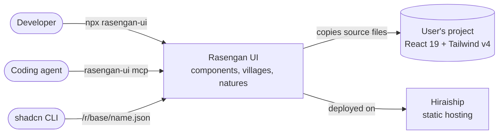
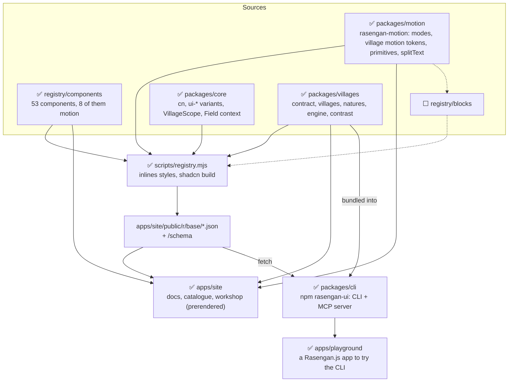
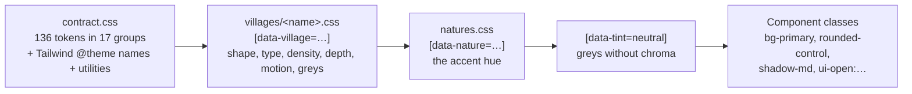
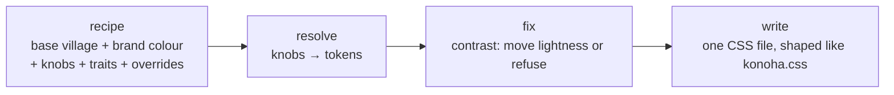
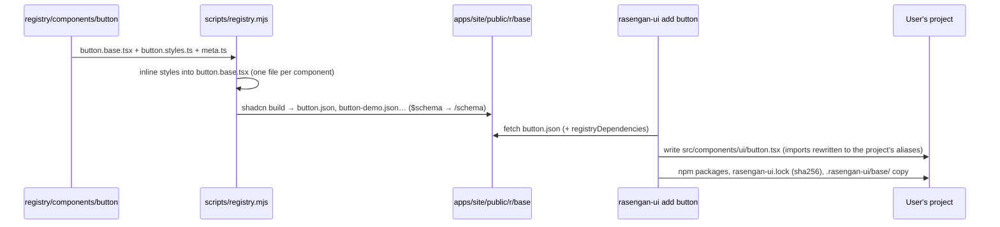

# Architecture

> **Living document**: it describes the system **as it is today** and what comes right after. Every pull request
> that changes a package, the registry pipeline, the CLI, the site or where something lives updates it in the same
> commit. The *why* is in the [RFCs](rfc/README.md) and the [ADRs](adr/README.md). The detail of the code is in the
> [code tour](code-tour.md).
>
> Last updated: 2026-11-07.

Legend: ✅ built · 🚧 started · ⬜ planned.

## 1. Context

Who uses Rasengan UI, and what it talks to.

- **Components are copied, not imported**: the CLI writes their source into the user's project, which owns it from
  then on. A lockfile and base copies let `update` merge later registry changes with local edits.
- **A village restyles everything at runtime**: one attribute on `<html>` (`data-village`, `data-nature`,
  `data-tint`), no rebuild.
- **The registry is shadcn-compatible**, so the shadcn CLI can install items too, without the village switching.
- Why: [RFC-0002](rfc/0002-villages.md), [RFC-0003](rfc/0003-mcp-server.md).

## 2. Containers

| Container | State | Role |
|---|---|---|
| `registry/components/<name>/` | ✅ 53 | One folder per component: `<name>.base.tsx`, `<name>.styles.ts`, `meta.ts` (with its category, [ADR-0009](adr/0009-component-categories.md)), demos |
| `registry/categories.ts` | ✅ | The seven categories, in the site's order: forms, dates, overlays, navigation, display, feedback, motion |
| `registry/blocks/` | ⬜ | Marketing blocks rebuilt on the components (RFC-0002, "Blocks"); empty |
| `packages/core` | ✅ | What every component shares; published as the `rasengan-core` registry item |
| `packages/villages` | ✅ | The token contract (CSS + TypeScript spec), the villages, the natures, the village engine, the contrast library |
| `packages/motion` | ✅ | The `rasengan-motion` registry item ([RFC-0007](rfc/0007-motion-components.md)): motion modes, the village's motion tokens read from CSS, `Reveal`, `Stagger`, `Presence`, `Parallax`, `Tilt`, `Magnetic`, `splitText`. Used by the five motion components of lot A |
| `packages/directions` | — | Empty leftover of RFC-0001; to delete |
| `scripts/registry.mjs` | ✅ | Builds the registry, one per engine (only `base` today) |
| `apps/site` | ✅ | The docs and catalogue site; serves the registry and its schemas; live at `rasengan-ui.hiraiship.app` |
| `packages/cli` | ✅ | `rasengan-ui` on npm (0.1.0): `init`, `add`, `village`, `nature`, `tint`, `diff`, `update`, `doctor`, `mcp` |
| `apps/playground` | ✅ | A Rasengan.js starter wired to the local registry |
| `archive/` | frozen | Rasengan UI v1, outside the workspace ([ADR-0003](adr/0003-v1-archived-old-urls-kept.md)) |

## 3. Theming: the token contract, villages and natures

- `contract.css` declares every token with a default, maps them to Tailwind names in `@theme`, and adds the
  utilities components use (`focus-ring`, `pressable`, `tone-*`, `lip-*`, `case-*`…). `contract.ts` describes the same
  tokens (group, kind, schemes, default) and a test checks the two never drift.
- A **village** is one CSS file that overrides contract tokens under `[data-village="<name>"]`, light and dark.
  Villages today: Konoha (default), Kiri, Iwa, Kusa (3D: controls stand on a lip, [ADR-0008](adr/0008-lip-in-the-token-contract.md)).
- A **nature** sets the accent (`--primary-h`, chroma…) under `[data-nature]`; natures are imported **after** villages.
  Six: Katon, Doton, Futon, Suiton, Raiton, and Onmyōton (no hue: the primary is the village's foreground).
- **Engine variants** (`ui-open`, `ui-checked`, `ui-invalid`…) in `packages/core/src/variants.css` match both Base
  UI's and Radix's state attributes, so one class string works on either engine.
- `VillageScope` gives part of a page its own village, nature, tint, scheme or motion intensity, and keeps a twin in
  `<body>` that popups use as their portal container.

### Motion

- Each village sets its motion through the recipe's `motion` knob: Konoha `calm`, Kiri `gentle`, Iwa `quick`, Kusa
  `bouncy`. It writes the durations and easings CSS transitions use, and (RFC-0007) the spring, travel distance,
  stagger and intensity (0 to 3) that motion components read. `data-motion-intensity` on any element overrides the
  intensity for its subtree; reduced motion sets it to 0 everywhere.
- `rasengan-motion` (`packages/motion`) reads those tokens from the element's computed style, so a component inside a
  `VillageScope` moves like that village. A head script sets `<html data-motion>`: `ready` animates, `final` renders end
  states (screenshots, agents), `off` is reduced motion. Hidden initial states apply only under `ready`, from
  `contract.css`, so content is visible without JavaScript.
- Reveals use the Web Animations API; components that need springs use Motion's `m`, whose features load on demand
  ([ADR-0010](adr/0010-motion-weight.md)).

### The village engine

Built-in villages are recipes too (`villages/*.recipe.json`), reproduced token for token. The same engine runs in the
CLI (`village create/check/export`) and in the site's workshop (`/villages/create`, in a web worker).
Why: [RFC-0006](rfc/0006-custom-villages.md).

## 4. From a component folder to a user's project

- Registry URL shape: `/r/<engine>/<name>.json`. Demos are `registry:example` items `<demo>-demo`, listed in the
  component's `meta.examples`, so agents can read them (RFC-0003).
- Shared code is published as `registry:lib` items (`rasengan-core`); villages as `registry:theme` items, one per
  village plus `rasengan-natures`.
- `rasengan-ui.json` at the project root holds the engine, village, nature, tint, aliases, registry and CSS file.
- `update` compares the base copy, the lock hash, the local file and the registry: behind → write, diverged → 3-way
  merge with conflict markers, deleted → stays deleted.

## 5. The site

- Rasengan.js 2 app, **prerendered** at build time and deployed on Hiraiship as static files
  ([ADR-0005](adr/0005-prerendered-site-on-hiraiship.md)). Dev server on port 3200.
- Pages: home, `/docs/*` (installation, CLI, MCP, villages), `/components` (by category) and `/components/<name>`
  (MDX, one per component, [ADR-0006](adr/0006-site-mdx-follows-hiraiship-docs.md)), `/motion` (the motion gallery:
  the village reveal and, from lot A, the motion components), `/villages/create` (the workshop).
- The header's sections: Docs, Components, Motion. The sidebar and the pager follow the catalogue's order: by category,
  then by title.
- `template.tsx` runs the motion head script; the root layout has the one `MotionProvider`.
- One settings store (`src/settings.ts`) drives the header's village, nature, tint and scheme; it writes `<html>`
  attributes and `localStorage`, restored before paint by an inline script in `template.tsx`.
- The site imports components from `registry/` through `@/components/ui/<name>` paths kept in sync by
  `scripts/registry.mjs`.

## 6. Quality gate

| Command | Checks | Needs |
|---|---|---|
| `pnpm typecheck` | core, villages, registry, site, CLI | — |
| `pnpm test` | villages (contract drift, contrast, engine), motion (server render, split text, defaults against the CSS) and CLI; also the pre-commit hook | — |
| `pnpm contrast` | every token pair of every village × nature × scheme against WCAG (text 4.5:1, control edges 3:1) | — |
| `pnpm axe` | WCAG 2.2 AA on every page × village × scheme, overlays open, `/motion` animating and with motion off; report in `.axe/report.md` | site running |
| `pnpm screenshots` | every demo × village × scheme × nature against a local baseline in `.screenshots/`; pages load with `?motion=final`, so motion components are captured in their end state | site running |

There is no CI yet: the gate runs locally (see the [roadmap](roadmap.md)).
